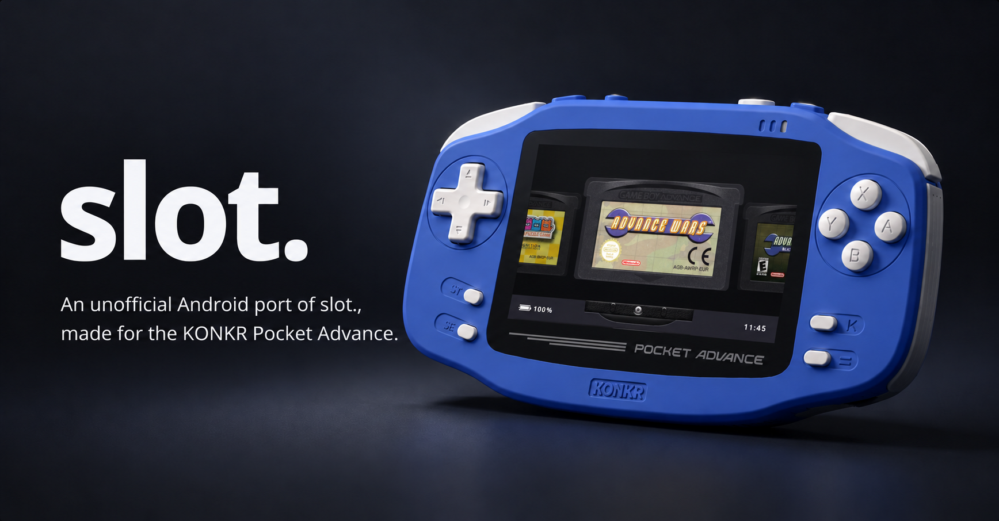
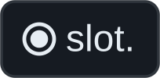

# slot. for KONKR Pocket Advance

*An unofficial Android port of [slot.](https://slot-cfw.fyi/#hero), made for the KONKR Pocket Advance.*

## Why I made this port

When I watched [Russ from Retro Game Corps showcase slot.](https://www.youtube.com/watch?v=vndbnpH0QoE&t=1167s), I immediately thought: *this would be perfect for the KONKR Pocket Advance.*

So I decided to bring slot. to Android, adding a few extra features along the way while staying true to the simplicity, charm, and philosophy of the original experience.

For me, the KONKR Pocket Advance is first and foremost a **dedicated Game Boy Advance handheld**. GBA is pretty much all I play on it, although slot. also supports Game Boy and Game Boy Color.

What makes this port special is how naturally slot. fits the hardware.

The round button on top of the KONKR feels like it was made for this. **Press it to insert a cartridge, then press and hold it while playing to eject it.** With the button positioned right where it is, there's something incredibly satisfying about the whole interaction. It almost feels like inserting and removing a real cartridge from a Game Boy Advance.

Sure, I wish the KONKR's buttons were a little less spongy, but I've gotten used to them!

And that's really what slot. is all about: **less time navigating menus, more time playing games.** Pick a cartridge, pop it in, and start playing. No unnecessary complexity, no distractions — just a simple, natural, cartridge-based experience.

My goal with this port is to preserve everything that makes the original slot. special, while making it feel right at home on the KONKR Pocket Advance.

## Features

Everything you love about the original slot., now on the KONKR Pocket Advance — with a few extra features that stay true to its original philosophy.

### The original slot. experience

- **A cartridge-first experience** — Browse your games as beautifully rendered physical cartridges, complete with satisfying insertion and ejection animations and sounds.
- **Made for Game Boy Advance** — GBA takes center stage, with dedicated shelves for Game Boy and Game Boy Color games.
- **Pick a cartridge and play** — No complicated menus or unnecessary distractions. Insert a cartridge and jump straight into your game.
- **Two emulation cores** — Choose between mGBA and gpSP, with individual game settings.
- **Cart Studio** — Customize your cartridges with authentic artwork, labels and shell colors.
- **All the essentials** — Save states, automatic saving, rewind, fast-forward, turbo buttons and rumble.
- **Make it yours** — Light and dark themes, wallpapers, favorites, recently played games, shaders, color correction and screen bezels.
- **Multiplayer** — The original Slot's Link Cable and Wireless Adapter experience, adapted for Android.

### What's added in this Android port?

Built specifically for the KONKR Pocket Advance

- **Native Android experience** — Designed for the KONKR's 3:2 display, physical controls and ARM64 hardware.
- **SLOT button** — Use the KONKR's round top button to insert a cartridge, or hold it while playing to save and eject it. It feels right at home on this handheld.
- **Easy library setup** — Choose your ROM folder directly from Android, with optional BIOS, saves and save states folders.
- **RetroArch save compatibility** — Share SRAM saves, RTC data and compatible save states with RetroArch, using the same folders and matching emulation cores.
- **Syncthing-friendly** — Keep your saves synchronized across devices by sharing your RetroArch save and state folders.
- **RetroAchievements, online and offline** — Earn achievements on supported GBA, GB and GBC games. Prepare your library while connected, then play offline and synchronize your unlocks when you're back online.
- **Multiplayer on Android** — Play compatible games over local Wi-Fi using mGBA Link Cable or gpSP Link Cable / Wireless RFU.
- **More GBA shaders** — Ten selectable GBA shader presets plus Off, including LCD3x, LCD Grid, Dot and display styles inspired by the original GBA and GBA SP.
- **Independent screen settings** — Configure GBA, GB and GBC shaders, color correction and bezels separately.
- **Optimized cartridge browsing** — Background artwork loading, persistent caching and GPU texture management designed to keep large libraries responsive.
- **Android app launcher** — Launch your other Android apps directly from Slot, with the option to make Slot your HOME launcher.
- **Clock format** — Choose 12-hour time with AM/PM or 24-hour time in **START → Settings → Interface → Time Format** (contributed by [Its-TroyM](https://github.com/Its-TroyM) in [PR #2](https://github.com/Baggio94/slot-for-kpa/pull/2)). Use Left/Right or A; your choice is saved. The default remains 24-hour time.

All of this without losing what makes slot. special: **the simple pleasure of choosing a cartridge, inserting it and playing.**

## Getting Started

Getting started with slot. is easy. Just point it to your games, pick a cartridge, and play!

### Installation

1. Download the latest APK from [Releases](https://github.com/Baggio94/slot-for-kpa/releases).
2. Install it on your KONKR Pocket Advance.
3. Open **slot.**

### First-time setup

On your first launch, you'll see a message asking you to press **START**.

1. Press **START** to open the menu.
2. Select **Library**.
3. Select **Choose ROM Folder** and pick the folder containing your games.
4. Grant Android permission to access the folder.
5. Wait for your cartridges to appear in the carousel. You're ready to play!

**Important:** ROMs must be unzipped. Supported formats are `.gba`, `.gbc` and `.gb`.

### Optional folders

In **START → Library**, you can also configure:

- **Choose BIOS Folder** — Use your own GBA, GB or GBC BIOS files.
- **Choose Save Folder** — Choose where your game saves are stored.
- **Choose Save State Folder** — Choose where your save states are stored.

**Already using RetroArch?** You can select the same save and save state folders to share compatible saves between both applications.

We'll cover RetroArch compatibility and Syncthing in more detail below.

### Updating slot.

Simply install the newer APK over your existing installation. **Do not uninstall the previous version or clear its data**, or you could lose your settings and locally stored saves.

## Controls & Hotkeys

The KONKR's round top button is called **slot. cap** in this port. Since it controls the cartridge experience, **slot. cap** felt like the most fitting name. Press it to insert a cartridge, or hold it while playing to save and eject it.

### Carousel

| Button | Action |
|---|---|
| <kbd>←</kbd> / <kbd>→</kbd> | Browse cartridges |
| <kbd>↑</kbd> / <kbd>↓</kbd> | Jump to the next or previous letter |
| <kbd>L1</kbd> / <kbd>R1</kbd> | Switch between GBA, GB and GBC shelves |
|  / <kbd>A</kbd> | Insert a cartridge and resume |
| Hold  / <kbd>A</kbd> | Start a game fresh |
| <kbd>Y</kbd> | Add or remove a favorite |
| <kbd>X</kbd> | Open the selected cartridge in Cart Studio |
| <kbd>SELECT</kbd> | Choose between mGBA and gpSP (GBA only) |
| <kbd>START</kbd> | Open the main menu |

### In Game

| Button | Action |
|---|---|
| Tap  | Open or close the in-game menu |
| Double-tap  | Open the Save State Switcher |
| Hold  | Save and eject the cartridge |
| <kbd>SELECT</kbd> +  | Open Multiplayer |
| <kbd>SELECT</kbd> + <kbd>R1</kbd> | Create a save state |
| <kbd>SELECT</kbd> + <kbd>L1</kbd> | Load the latest save state |
| Hold <kbd>R2</kbd> | Fast-forward |
| Double-tap <kbd>R2</kbd> | Lock or unlock fast-forward |
| Hold <kbd>L2</kbd> | Rewind |
| Hold <kbd>X</kbd> / <kbd>Y</kbd> | Turbo A / B (when enabled) |
| <kbd>SELECT</kbd> + <kbd>B</kbd> / <kbd>A</kbd> | Previous / next shader |
| <kbd>SELECT</kbd> + <kbd>Y</kbd> | Toggle color correction |
| <kbd>SELECT</kbd> + <kbd>L2</kbd> / <kbd>R2</kbd> | Change GB palette (when enabled) |
| <kbd>L1</kbd> / <kbd>R1</kbd> | Stretch / original screen size (GB/GBC only) |

### Save State Switcher

| Button | Action |
|---|---|
| <kbd>←</kbd> / <kbd>→</kbd> | Browse save states |
| <kbd>A</kbd> | Load the selected state |
| <kbd>Y</kbd> | Delete the selected state |
| <kbd>X</kbd> | Undo the last save or load (within 30 seconds) |
| <kbd>B</kbd> | Return to the game |

**Note:** Unlike the original slot., this Android port uses **START** to open the main menu and **SELECT** to choose the emulator core on the carousel.

## Cart Studio

Give your cartridges the artwork they deserve!

slot. for KONKR Pocket Advance includes the original **[Cart Studio](https://studio.slot-cfw.fyi/)**, integrated directly into the app. No computer required.

### Adding cartridge artwork

1. Press **START → Cart Studio** from the carousel.
2. Wait for Cart Studio to load your library and match your games with available artwork.
3. For cartridges without artwork, select a cartridge to open its editor.
4. Search for the game, select the correct match, and choose your preferred label and cartridge style.
5. Tap the **✕ in the top-right corner of the editor** to return to the cartridge list.
6. Repeat for any remaining games, then press **Save to slot.** to apply your changes.

**Important:** Don't press **B / BACK** until you've finished editing and saved your artwork. Use the editor's **✕** to return to the cartridge list without leaving Cart Studio.

### Quick editing

Want to customize just one cartridge? Highlight it on the carousel and press **X** to open it directly in Cart Studio.

You can also use **Fill unlabelled** to speed up artwork selection for cartridges without labels.

Once saved, your customized cartridges will appear in the slot. carousel.

## Saves, RetroArch & Syncthing

Your saves, wherever you play.

slot. is compatible with RetroArch's save files and save states, so you can pick up right where you left off.

- Go to **START → Library** and select the same **Save Folder** and **Save State Folder** used by RetroArch.
- Enable RetroArch's option to organize saves and states into folders by core.
- Use **Syncthing** to keep these shared folders synchronized across your devices.

**Note:** Save states are core-specific. Use the same emulator core (mGBA or gpSP) in both apps for compatibility.

## RetroAchievements

Earn achievements online or offline — even with Wi-Fi turned off!

slot. supports [RetroAchievements](https://retroachievements.org/) for **GBA, GB and GBC** games.

1. Open **START → RetroAchievements** and sign in to your account.
2. Stay connected to Wi-Fi while slot. prepares your game library and downloads achievement data.
3. Once your games are cached, **play completely offline** and keep earning achievements.
4. Reconnect to Wi-Fi whenever you like to automatically sync your offline unlocks.

**No need to keep Wi-Fi enabled while playing!** Just connect occasionally to sync your achievements and refresh your game data.

*Achievements require supported ROMs and an initial online preparation.*

## Multiplayer

Link up with another KONKR Pocket Advance, just like the good old days!

slot. supports multiplayer over local Wi-Fi, with two emulation cores:

- **mGBA** — Link Cable for compatible GBA, GB and GBC games.
- **gpSP** — Link Cable and Wireless RFU for compatible GBA games, including Pokémon trading.

### How to connect

1. Connect both devices to the same Wi-Fi network.
2. Launch compatible games using the same emulator core.
3. Press <kbd>SELECT</kbd> +  or open **Pause → Multiplayer**.
4. Choose **Host** on one device and **Join** on the other.
5. Once connected, enjoy multiplayer!

**Note:** Both devices should run compatible versions of slot. Multiplayer support depends on the game, core and connection mode.

## Credits & License

slot. for KONKR Pocket Advance wouldn't exist without the incredible work of the original creators.

Special thanks to:

- **[Brandon Kowalski](https://github.com/BrandonKowalski/slot)** — Creator of the original [slot.](https://slot-cfw.fyi/) and its wonderful cartridge-first experience.
- **[Markus](https://github.com/MarkusMaribu)** — The beautiful skeuomorphic artwork that gives slot. its unique identity.
- **[pvaibhav](https://github.com/pvaibhav/slot)** — Contributions and improvements inherited from the Slot fork.
- **[mGBA](https://mgba.io/), [gpSP](https://github.com/libretro/gpsp), [libretro](https://www.libretro.com/) and [RetroAchievements](https://retroachievements.org/)** — The projects and contributors powering emulation and achievements.

This is an **unofficial community port**, not affiliated with or endorsed by the original Slot developers or the KONKR Pocket Advance manufacturer.

The Slot-derived source code is distributed under the **[GNU GPL-3.0](LICENSE)**. Third-party components retain their respective licenses and copyright notices.

**Thank you to everyone who made this possible!**
