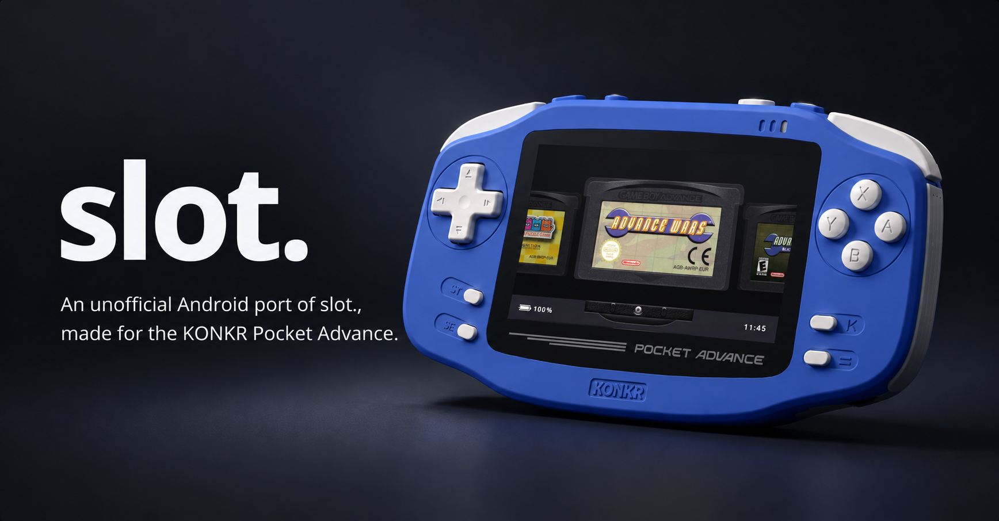
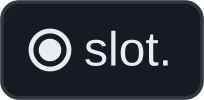

# slot. for Android

*An unofficial Android port of [slot.](https://slot-cfw.fyi/#hero) for Android handhelds — born on the KONKR Pocket Advance.*

## Why I made this port

When I watched [Russ from Retro Game Corps showcase slot.](https://www.youtube.com/watch?v=vndbnpH0QoE&t=1167s), I immediately thought: *this would be perfect for the KONKR Pocket Advance.*

So I decided to bring slot. to Android, adding a few extra features along the way while staying true to the simplicity, charm, and philosophy of the original experience.

For me, the KONKR Pocket Advance is first and foremost a **dedicated Game Boy Advance handheld**. GBA is pretty much all I play on it, although slot. also supports Game Boy and Game Boy Color.

What makes this port special is how naturally slot. fits the hardware.

The round button on top of the KONKR feels like it was made for this. **Press it to insert a cartridge, then press and hold it while playing to eject it.** With the button positioned right where it is, there's something incredibly satisfying about the whole interaction. It almost feels like inserting and removing a real cartridge from a Game Boy Advance.

Sure, I wish the KONKR's buttons were a little less spongy, but I've gotten used to them!

And that's really what slot. is all about: **less time navigating menus, more time playing games.** Pick a cartridge, pop it in, and start playing. No unnecessary complexity, no distractions — just a simple, natural, cartridge-based experience.

Since then, slot. has grown beyond the KONKR. It now adapts to any Android handheld screen, from square displays like the Retroid Pocket Classic to widescreen devices, and it welcomes the NES, Super Nintendo and Mega Drive next to the Game Boy family — each with its own cartridges, slot and multiplayer.

My goal with this port is to preserve everything that makes the original slot. special, while making it feel right at home on every Android handheld.

## Features

Everything you love about the original slot., now on Android handhelds — with a few extra features that stay true to its original philosophy.

### The original slot. experience

- **A cartridge-first experience** — Browse your games as beautifully rendered physical cartridges, complete with satisfying insertion and ejection animations and sounds.
- **Made for Game Boy Advance** — GBA takes center stage, with dedicated shelves for Game Boy and Game Boy Color games.
- **Pick a cartridge and play** — No complicated menus or unnecessary distractions. Insert a cartridge and jump straight into your game.
- **Cart Studio** — Customize your cartridges with authentic artwork, labels and shell colors.
- **All the essentials** — Save states, automatic saving, rewind, fast-forward, turbo buttons and rumble.
- **Make it yours** — Light and dark themes, wallpapers, favorites, recently played games, shaders, color correction and screen bezels.
- **Multiplayer** — The original slot.'s Link Cable and Wireless Adapter experience, adapted for Android.

### What's added in this Android port?

- **NES, Super Nintendo and Mega Drive** — Three home consoles join the Game Boy family, each with its own shelf, cartridge shells (including Famicom and Japanese Mega Drive moulds), console slot, Cart Studio labels, RetroAchievements and multiplayer.
- **Two emulation cores per system** — mGBA or gpSP for GBA, mGBA or Gambatte for GB and GBC, FCEUmm or Nestopia for NES, Snes9x or bsnes for SNES, Genesis Plus GX or PicoDrive for Mega Drive. Choose a default core per system, or a different one for any game.
- **Made for every Android handheld** — The interface fills any screen shape, from square (1:1) to widescreen, at the panel's native resolution. Screen sizes, overlays and frame pacing get sensible defaults for each handheld.
- **SLOT button** — On the KONKR, use the round top button to insert a cartridge, or hold it while playing to save and eject it. The Retroid Pocket's centre key works the same way, and on every handheld SELECT + X opens the in-game menu and SELECT + START saves and ejects the cartridge.
- **Easy library setup** — Choose your ROM folder directly from Android, with optional BIOS, saves and save states folders. ES-DE style folders are recognised.
- **RetroArch save compatibility** — Share SRAM saves, RTC data and compatible save states with RetroArch, using the same folders and matching emulation cores.
- **Share Core Saves** — Switch any game to its other core and keep your in-game save, on every system.
- **Syncthing-friendly** — Keep your saves synchronized across devices by sharing your RetroArch save and state folders.
- **RetroAchievements, online and offline** — Earn achievements on every system. Prepare your library while connected, then play offline and synchronize your unlocks when you're back online.
- **Multiplayer on Android** — Play over local Wi-Fi: mGBA Link Cable for GBA, GB and GBC, gpSP Link Cable and Wireless Adapter for GBA, and two-player netplay for NES, Super Nintendo and Mega Drive. Each console plugs in its own connector.
- **Shaders for every system** — Ten GBA shader presets, Game Boy LCD shaders, and CRT shaders for the home consoles (zfast-crt, fakelottes, crt-aperture, GDV Trinitron, CRT Geom Deluxe, crt-pi), plus Pixel AA for clean pixels at any scale.
- **Independent system settings** — Configure the default core, shader, color correction, screen size and overlay of each system separately in **START → Settings → Systems**.
- **Screen sizes and overlays** — Integer, Original Ratio or Stretch, with [Watomsk](https://github.com/Watomsk/Overlays)'s overlays for every system.
- **Optimized cartridge browsing** — Background artwork loading, persistent caching and GPU texture management designed to keep large libraries responsive.
- **Android app launcher** — Launch your other Android apps directly from slot., with the option to make slot. your HOME launcher.

All of this without losing what makes slot. special: **the simple pleasure of choosing a cartridge, inserting it and playing.**

## Getting Started

1. Download the latest APK from [Releases](https://github.com/Baggio94/slot-for-kpa/releases/latest) and install it on your Android handheld (ARM64, Android 12 or later).
2. Open **slot.**, press **START → Library → Choose ROM Folder** and pick the folder containing your games.
3. Your cartridges appear in the carousel. Pick one and play!

**Supported files:** `.gba`, `.gb`, `.gbc`, `.nes`, `.fc`, `.unf`, `.unif`, `.sfc`, `.smc`, `.md`, `.gen`, `.smd`, `.bin`, and `.zip` archives holding one game each. Keep your games in one folder or in one folder per system, ES-DE style.

### Optional folders

In **START → Library**, you can also configure:

- **Choose BIOS Folder** — Use your own GBA, GB or GBC BIOS files.
- **Choose Save Folder** — Choose where your game saves are stored.
- **Choose Save State Folder** — Choose where your save states are stored.

**Already using RetroArch?** You can select the same save and save state folders to share compatible saves between both applications.

We'll cover RetroArch compatibility and Syncthing in more detail below.

### Updating slot.

slot. checks for updates and can install them for you from **START → About**. You can also install the newer APK over your existing installation. **Do not uninstall the previous version or clear its data**, or you could lose your settings and locally stored saves.

## Controls & Hotkeys

The KONKR's round top button is called **slot. cap** in this port. Since it controls the cartridge experience, **slot. cap** felt like the most fitting name. Press it to insert a cartridge, or hold it while playing to save and eject it.

**On other handhelds:** the Retroid Pocket's round centre key is the slot. cap. On any handheld, **SELECT + X** works like a tap on the slot. cap while playing, and **SELECT + START** saves and ejects the cartridge.

### Carousel

| Button | Action |
|---|---|
| <kbd>←</kbd> / <kbd>→</kbd> | Browse cartridges |
| <kbd>↑</kbd> / <kbd>↓</kbd> | Jump to the next or previous letter |
| <kbd>L1</kbd> / <kbd>R1</kbd> | Switch shelves: GBA, GB, GBC, NES, SNES, Mega Drive, Recents and Favorites |
|  / <kbd>A</kbd> | Insert a cartridge and resume |
| Hold  / <kbd>A</kbd> | Start a game fresh |
| <kbd>Y</kbd> | Add or remove a favorite |
| <kbd>X</kbd> | Open the selected cartridge in Cart Studio |
| <kbd>SELECT</kbd> | Choose the emulator core for this game |
| <kbd>START</kbd> | Open the main menu |

### In Game

| Button | Action |
|---|---|
| Tap  | Open or close the in-game menu |
| Double-tap  | Open the Save State Switcher |
| Hold  | Save and eject the cartridge |
| <kbd>SELECT</kbd> + <kbd>X</kbd> | Same as a tap on the slot. cap |
| <kbd>SELECT</kbd> + <kbd>START</kbd> | Save and eject the cartridge |
| <kbd>SELECT</kbd> +  | Open Multiplayer |
| <kbd>SELECT</kbd> + <kbd>R1</kbd> | Create a save state |
| <kbd>SELECT</kbd> + <kbd>L1</kbd> | Load the latest save state |
| Hold <kbd>R2</kbd> | Fast-forward |
| Double-tap <kbd>R2</kbd> | Lock or unlock fast-forward |
| Hold <kbd>L2</kbd> | Rewind |
| Hold <kbd>X</kbd> / <kbd>Y</kbd> | Turbo A / B (when enabled) |
| <kbd>SELECT</kbd> + <kbd>B</kbd> / <kbd>A</kbd> | Previous / next shader |
| <kbd>SELECT</kbd> + <kbd>Y</kbd> | Toggle color correction |
| <kbd>SELECT</kbd> + <kbd>L2</kbd> / <kbd>R2</kbd> | Change GB palette (Game Boy games, when enabled) |
| <kbd>SELECT</kbd> + <kbd>Up</kbd> / <kbd>Down</kbd> | Bigger / smaller screen: Integer, Original Ratio, Stretch |
| <kbd>SELECT</kbd> + <kbd>Left</kbd> / <kbd>Right</kbd> | Run-Ahead: Off, 1 frame, 2 frames |
| <kbd>L1</kbd> / <kbd>R1</kbd> | Bigger / smaller screen (GB, GBC and NES, whose games don't use these buttons) |

### Save State Switcher

| Button | Action |
|---|---|
| <kbd>←</kbd> / <kbd>→</kbd> | Browse save states |
| <kbd>A</kbd> | Load the selected state |
| <kbd>Y</kbd> | Delete the selected state: <kbd>X</kbd> confirms, <kbd>B</kbd> keeps it |
| <kbd>X</kbd> | Undo the last save or load (within 30 seconds) |
| <kbd>B</kbd> | Return to the game |

**Note:** Unlike the original slot., this Android port uses **START** to open the main menu and **SELECT** to choose the emulator core on the carousel.

### Boktai: the Sun

Boktai 1, 2 and 3 read real sunlight through a sensor on the cartridge. In slot., you choose the sun for each game.

**Calibrate first.** The first time a Boktai game starts, it calibrates its solar sensor and expects darkness. Make sure the Sun is at **0** at that moment, or the gauge will never fill. To calibrate again later, set the Sun to 0 and run the calibration from the game's own options.

**Set the Sun** in the in-game menu, **Settings → Emulation → Sun**. It's saved for each game:

- **0 to 8** in Boktai 1, **0 to 10** in Boktai 2 and 3 — one bar of the gauge per level.
- **SENSOR** — the handheld's light sensor, on handhelds that have one.
- **AUTO** — follows the time of day: night until 6:00, full sun at 13:00, night again from 20:00.

| Button | Action |
|---|---|
| <kbd>R3</kbd> or <kbd>SELECT</kbd> + <kbd>R2</kbd> | More sun |
| <kbd>L3</kbd> or <kbd>SELECT</kbd> + <kbd>L2</kbd> | Less sun |

The shortcuts go through every setting in order: 0, 1 … 8 or 10, SENSOR, AUTO, then back to 0. A banner shows the new setting. The Sun can't be changed during Multiplayer.

## Cart Studio

Your cartridges dress themselves: slot. fetches their labels automatically while you're online, for every system.

Want a different label or cartridge style? slot. also includes the original **[Cart Studio](https://studio.slot-cfw.fyi/)**, integrated directly into the app. It's optional, and no computer is required.

### Changing cartridge artwork

1. Press **START → Cart Studio** from the carousel.
2. Wait for Cart Studio to load your library.
3. Select a cartridge to open its editor.
4. Search for the game, select the correct match, and choose your preferred label and cartridge style.
5. Tap the **✕ in the top-right corner of the editor** to return to the cartridge list.
6. Repeat for any other games, then press **Save to slot.** to apply your changes.

**Important:** Don't press **B / BACK** until you've finished editing and saved your artwork. Use the editor's **✕** to return to the cartridge list without leaving Cart Studio.

### Quick editing

Want to customize just one cartridge? Highlight it on the carousel and press **X** to open it directly in Cart Studio.

You can also use **Fill unlabelled** to speed up artwork selection for cartridges without labels.

Once saved, your customized cartridges will appear in the slot. carousel.

## Saves, RetroArch & Syncthing

Your saves, wherever you play.

slot. is compatible with RetroArch's save files and save states, so you can pick up right where you left off.

- Go to **START → Library** and select the same **Save Folder** and **Save State Folder** used by RetroArch.
- Enable RetroArch's option to organize saves and states into folders by core.
- Use **Syncthing** to keep these shared folders synchronized across your devices.

**Note:** Save states are core-specific. Use the same emulator core in both apps for compatibility.

**Share Core Saves:** turn it on in **START → Library**, and when you switch a game to its other core, slot. carries your in-game save over, so you can keep playing where you left off. It works on every system. If both cores already have a different save for a GBA game, slot. asks which one to keep.

## RetroAchievements

Earn achievements online or offline — even with Wi-Fi turned off!

slot. supports [RetroAchievements](https://retroachievements.org/) for **GBA, GB, GBC, NES, SNES and Mega Drive** games. On Super Nintendo, achievements need Snes9x (bsnes doesn't support them).

1. Open **START → RetroAchievements** and sign in to your account.
2. Stay connected to Wi-Fi while slot. prepares your game library and downloads achievement data.
3. Once your games are cached, **play completely offline** and keep earning achievements.
4. Reconnect to Wi-Fi whenever you like to automatically sync your offline unlocks.

**No need to keep Wi-Fi enabled while playing!** Just connect occasionally to sync your achievements and refresh your game data.

*Achievements require supported ROMs and an initial online preparation.*

## Multiplayer

Link up with another Android handheld, just like the good old days!

slot. supports multiplayer over local Wi-Fi:

- **mGBA** — Link Cable for compatible GBA, GB and GBC games. Both consoles may use different BIOS files, or none at all.
- **gpSP** — Link Cable and Wireless Adapter for compatible GBA games, including Pokémon trading. Press **SELECT** in the Multiplayer screen to switch between them when a game supports both.
- **Gambatte** — Link Cable for GB and GBC games.
- **NES, Super Nintendo and Mega Drive** — Two-player netplay, with player 1 on the Host and player 2 on the Join console. On Super Nintendo, use Snes9x.

### How to connect

1. Connect both devices to the same Wi-Fi network.
2. Launch the same game using the same emulator core on both devices.
3. Press <kbd>SELECT</kbd> +  or open **Pause → Multiplayer**.
4. Choose **Host** on one device and **Join** on the other.
5. Once connected, enjoy multiplayer!

**Note:** Both devices should run the same version of slot. Multiplayer support depends on the game, core and connection mode.

## Credits & License

slot. for Android wouldn't exist without the incredible work of the original creators.

Special thanks to:

- **[Brandon Kowalski](https://github.com/BrandonKowalski/slot)** — Creator of the original [slot.](https://slot-cfw.fyi/) and its wonderful cartridge-first experience.
- **[Markus](https://github.com/MarkusMaribu)** — The beautiful skeuomorphic artwork that gives slot. its unique identity.
- **[pvaibhav](https://github.com/pvaibhav/slot)** — Contributions and improvements inherited from the Slot fork.
- **[Watomsk](https://github.com/Watomsk/Overlays)** — The screen overlays for every system, used with permission.
- **[mGBA](https://mgba.io/), [gpSP](https://github.com/libretro/gpsp), [Gambatte](https://github.com/libretro/gambatte-libretro), [FCEUmm](https://github.com/libretro/libretro-fceumm), [Nestopia](https://github.com/libretro/nestopia), [Snes9x](https://github.com/libretro/snes9x), [bsnes](https://github.com/libretro/bsnes-libretro), [Genesis Plus GX](https://github.com/libretro/Genesis-Plus-GX), [PicoDrive](https://github.com/libretro/picodrive), [libretro](https://www.libretro.com/) and [RetroAchievements](https://retroachievements.org/)** — The projects and contributors powering emulation and achievements.
- **The libretro shader authors** — LCD and CRT shaders by Gigaherz, Themaister, Greg Hogan, jdgleaver, cgwg, hunterk, Pokefan531, endrift, davej, guest(r), Timothy Lottes and EasyMode.
- **[ScreenScraper](https://www.screenscraper.fr/)** — Cartridge labels and artwork.

This is an **unofficial community port**, not affiliated with or endorsed by the original Slot developers or any handheld manufacturer.

The Slot-derived source code is distributed under the **[GNU GPL-3.0](LICENSE)**. Third-party components retain their respective licenses and copyright notices.

**Thank you to everyone who made this possible!**
